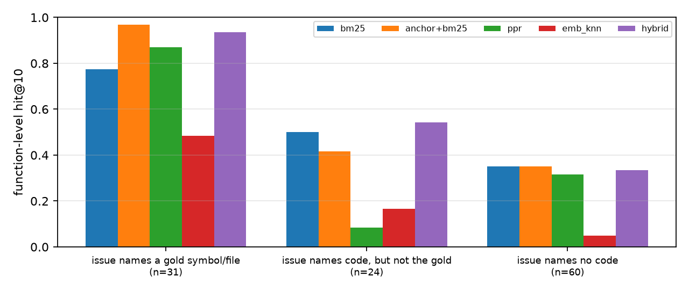

# Where the Fix Lives

### Lexical anchors, not graph structure, decide bug localization in the Gemma 4 Developer Agent benchmark, and what that means for small local models

Alan De Bortolo, Design Master Solutions LLC

## Abstract

Before an agent can repair a repository it has to find the code to change. The Gemma 4 Developer
Agent benchmark ships, for each of its 129 tasks, a pre-built call graph and per-symbol embeddings
precisely to help with that search. We ask where the gold edit actually lives relative to what the
issue text says, and whether the provided graph and embeddings help a small local model find it.
We map every gold patch onto the provided graph by parsing the upstream source at the task's base
commit, producing function-level localization labels for 115 tasks and file-level labels for 128.
Only 27% of tasks name a gold function or file in the issue; 52% name no code at all. We then
evaluate training-free rankers that use nothing but the issue and the provided artifacts: BM25,
embedding nearest neighbours, personalized PageRank (PPR) from issue anchors, an anchor-first
BM25, and a reciprocal-rank-fusion hybrid. The hybrid lifts function-level hit@1 from 0.12 (BM25)
to 0.23 (paired difference +0.10, 95% CI [+0.03, +0.18]), but almost all of the gain comes from
the lexical anchors themselves: graph propagation helps only when the issue already names the
gold symbol, hurts badly when it names other code (hit@10 0.08 vs 0.50 for BM25), and nothing we
tried beats about 0.35 hit@10 when the issue names no code. The provided embeddings cannot embed
the issue text and are the weakest signal. Finally, we run Gemma 4 E4B locally with llama.cpp and
show RQ3_HEADLINE. We release the label-building pipeline, the rankers, the model predictions and
a public notebook that regenerates every number from the competition data.

## 1. Introduction

Agentic repair systems spend most of their budget on navigation: listing directories, grepping,
opening files, and only then editing. For a small model that runs on a laptop, every wasted tool
call is expensive, and the context window cannot hold a whole repository. The Gemma 4 Developer
Agent competition anticipates this by giving agents three code-intelligence tools backed by
pre-computed artifacts: `get_code_neighbors` and `get_code_subgraph` over a NetworkX call graph,
and `search_similar_code` over per-symbol embeddings. A natural hypothesis, and the one we set out
to test, is that the graph lets an agent walk from what the issue mentions to what must be edited.

We find a more nuanced and, we think, more useful picture. The question that decides whether
localization is easy is not "how far is the fix in the graph?" but "does the issue name the fix?".
Our contributions:

1. **Labels and a pipeline.** The benchmark's graph nodes are dotted symbol paths with code but
   no file or line information. We recover file and line spans for 95% of all graph nodes by
   parsing the upstream source at each base commit, and map every touched line of every gold patch
   to its innermost enclosing function or class (Section 2). The pipeline is generic: it needs a
   unified diff, a git repository and a list of dotted symbol names.
2. **A structural census (RQ1)** of where the fix lives relative to the issue's lexical anchors
   and the call graph.
3. **A controlled comparison of training-free rankers (RQ2)** with bootstrap confidence intervals
   and paired tests, broken down by anchor regime. The negative results are as informative as the
   positive one.
4. **A small-model experiment (RQ3)**: does Gemma 4 E4B, running locally, localize better when
   given the top-20 candidates of a ranker than when given the repository's file list?

## 2. Data and labels

**Tasks.** The benchmark has 129 tasks from four Python repositories: fastapi (67), rich (48),
requests (13) and httpx (1). Each provides `problem_statement`, `base_commit`, a gold `patch`
(source only; tests are in a separate `test_patch`) and an empty `hints_text`. Many fastapi
statements are pull-request titles followed by the description, so they read more like change
requests than bug reports. 127 distinct base commits come with a graph and an embedding file.

**Provided artifacts.** Each graph is a directed multigraph whose only edge type is `calls`; nodes
are functions and classes named by dotted paths (for example `rich.console.Console.print_json`),
each with its source text. For the 115 tasks in our function-level set, the median graph has 1,155
non-test candidate nodes and 766 undirected call edges. Each embedding file holds one 256-d
vector per node. The harness documentation states that `search_similar_code` resolves its query
against node names, because the sandbox has no encoder: a free-text issue cannot be embedded in
the same space. Every gold node has an embedding, and only one task's gold nodes are all isolated
in the call graph, so neither artifact is missing where it matters.

**Mapping nodes to files.** Node names omit file paths and sometimes drop leading directories
(fastapi's `docs_src/` tutorials appear as top-level modules). For each `.py` file at the base
commit we parse it with Python's `ast`, enumerate every class and function with its qualified
name and line span (decorators included), generate candidate module names by stripping leading
path components, and keep the candidate under which most of the file's definitions exist in the
graph. Across all 127 commits this maps 95.2% of graph nodes to a file and span.

**Gold labels.** We parse each gold patch into touched files and old-side line numbers: removed
lines, plus, for pure insertions, the line the insertion follows. Each touched line is attributed
to the innermost enclosing definition, so a new method inserted between two methods counts as an
edit to its class. Of 4,093 touched old-side lines, 2,619 fall inside a graph node, 347 inside a
definition the graph lacks (mostly nested functions), and 1,127 at module level (imports,
constants). 14 tasks have no gold graph node: one only adds a new file and 13 only change
module-level code. Our function-level evaluation set therefore has 115 tasks (median one gold
node, mean four), and the file-level set has 128 tasks with at least one edited existing `.py`
file. Test-module nodes are excluded from both candidates and gold, since no gold patch edits
tests. We checked the labels of three randomly sampled tasks against their diffs by hand.

**Data policy.** The competition rules forbid redistributing competition data, so our repository
contains code and aggregate results only. Per-task labels are regenerated from the attached
competition data by the public notebook.

## 3. RQ1: where does the fix live?

**Anchors.** We extract from the issue every identifier that looks like code: anything in
backticks, dotted names, snake_case and CamelCase words, and names followed by `(`, minus a short
stop-list of English words that double as symbol names (`get`, `run`, `request`...). An identifier
anchors a graph node if it equals the node's last one or two name components. A `.py` path or a
traceback frame anchors every node of the matching file.

| quantity (n = 115 function-level tasks unless noted) | value [95% CI] |
|---|---|
| gold edit touches a single file (n = 129) | 0.70 [0.62, 0.78] |
| task adds a new file (n = 129) | 0.09 [0.04, 0.14] |
| issue names any `.py` file (n = 128) | 0.09 [0.04, 0.13] |
| issue anchors any graph node | 0.48 [0.39, 0.57] |
| issue anchors a gold node | 0.27 [0.19, 0.35] |
| gold within 1 / 2 / 3 call hops of an anchor (n = 55 anchored) | 0.62 / 0.69 / 0.82 |

So the tasks split into three regimes: the issue names a gold symbol or file (31 tasks, 27%),
it names other code but not the gold (24, 21%), or it names no code (60, 52%). When an issue does
name code, the gold is usually close in the call graph: 82% of anchored tasks have a gold node
within three hops. That looks promising for graph search, but the median three-hop neighbourhood
of the anchors already holds 7.8% of all candidates, about 90 functions in a median-sized
repository, so "within three hops" is not by itself a useful filter.

## 4. RQ2: training-free localization priors

**Rankers.** All rankers score the non-test graph nodes of one task using only the issue text and
the provided artifacts; nothing is trained or tuned on the benchmark.

* **BM25** (Okapi, `rank_bm25`) over each node's name tokens (weighted ×3) plus its code, both
  split on `_`, `.` and camelCase.
* **Anchor+BM25**: anchored nodes first, ordered by BM25, then the rest of the BM25 ranking.
* **PPR**: personalized PageRank (α = 0.85) on the undirected call graph, restarting uniformly on
  up to 20 anchors (BM25-ordered); with no anchors, on the BM25 top-5 (pseudo-relevance feedback).
* **Embedding kNN**: cosine similarity to the mean embedding of the same seeds. This is the best
  the provided embeddings allow, since the issue itself cannot be embedded.
* **Hybrid**: reciprocal rank fusion (k = 60) of anchor+BM25, BM25, PPR and kNN with weights
  2, 1, 1, 0.5, fixed before any result was computed.

Function-level hit@k is 1 if any gold node is among the top k; file-level rankings come from the
node rankings (the first occurrence of each file). Intervals are 95% percentile bootstrap over
tasks (2,000 resamples); differences are paired bootstraps.

| ranker | func @1 | func @10 | func MRR | file @1 | file @10 |
|---|---|---|---|---|---|
| random | 0.00 | 0.05 | 0.02 | 0.01 | 0.41 |
| BM25 | 0.12 [0.07, 0.18] | 0.50 [0.40, 0.58] | 0.25 | 0.31 | 0.78 |
| embedding kNN | 0.10 [0.04, 0.15] | 0.19 [0.12, 0.27] | 0.13 | 0.25 | 0.67 |
| PPR | 0.11 [0.06, 0.17] | 0.42 [0.33, 0.50] | 0.23 | 0.35 | 0.77 |
| anchor+BM25 | 0.22 [0.15, 0.30] | 0.53 [0.44, 0.63] | 0.32 | 0.37 | 0.80 |
| hybrid | **0.23** [0.15, 0.31] | **0.54** [0.45, 0.63] | **0.34** | **0.41** | **0.82** |

(File-level random is high because rich and requests have few non-test source files.)

The hybrid beats BM25 at hit@1 for functions (+0.10 [+0.03, +0.18]) and files (+0.09 [+0.02,
+0.16]); at hit@10 the gain shrinks to +0.04 and its interval touches zero. PPR alone is no better
than BM25, and embedding kNN is clearly worse (hit@10 −0.30 [−0.41, −0.21]). Against anchor+BM25,
the hybrid's advantage is +0.01 at both cut-offs, with intervals centred on zero. Varying the
fusion weights (five settings, including dropping PPR and kNN) moves function hit@1 between 0.19
and 0.24 and hit@10 between 0.51 and 0.54, so the conclusion does not hinge on the weights.

**The regime explains the averages** (function-level hit@10):

| regime | n | BM25 | anchor+BM25 | PPR | kNN | hybrid |
|---|---|---|---|---|---|---|
| issue names a gold symbol/file | 31 | 0.77 | **0.97** | 0.87 | 0.48 | 0.94 |
| issue names code, but not the gold | 24 | 0.50 | 0.42 | 0.08 | 0.17 | **0.54** |
| issue names no code | 60 | **0.35** | **0.35** | 0.32 | 0.05 | 0.33 |

When the issue names the gold, putting anchors first is nearly sufficient: hit@1 rises from
0.26 to 0.68, and hit@10 to 0.97. When it names other code, a graph walk from those anchors is
actively harmful: PPR loses 0.42 [0.21, 0.63] of hit@10 against plain BM25, because the restart
mass concentrates around the wrong symbols and their high-degree neighbours. The hybrid survives
this regime only because BM25 is still in the fusion. When the issue names no code, all methods
sit near 0.35 and graph or embedding signals add nothing.

**Takeaway for tool design.** For this benchmark, the cheapest, most reliable first step for an
agent is lexical: pull identifiers out of the issue, resolve them against the graph's node names,
and read those first. `get_code_neighbors` is worth calling from a node the agent has confirmed
to be relevant, not from whatever the issue happens to mention. `search_similar_code` is a
symbol-to-symbol tool and should not be used as a text search.

## 5. RQ3: does the prior help a small local model?

**Setup.** We serve Gemma 4 E4B (instruction-tuned, Q8_0 GGUF from `ggml-org/gemma-4-E4B-it-GGUF`)
with llama.cpp on an Apple M5 Max, temperature 0, at most 4,096 generated tokens (the model's
default thinking mode stays on). The model sees the issue (truncated to 6,000 characters) and one
of three contexts, and must answer with a JSON list of up to five `path.py::QualifiedName` strings:

* **tree**: every non-test `.py` path in the repository (median about 10k prompt tokens for fastapi);
* **bm25_top20**: the top 20 BM25 candidates, presented most-likely-first;
* **hybrid_top20**: the top 20 hybrid candidates, same format.

A prediction hits a gold function if the path matches and the qualified name equals the gold
name or encloses it (a class for one of its methods). File hits only compare paths.

RQ3_TABLE

RQ3_TEXT

## 6. Limitations

The benchmark is small (115 function-level tasks from four repositories, dominated by fastapi and
rich), so intervals are wide; the regime analysis has 24 to 60 tasks per cell. Many fastapi
statements are pull-request descriptions written by the person who made the change, which
probably makes anchors more frequent than in user-reported bugs. Our gold labels inherit the
benchmark's choices: a patch may touch more functions than strictly necessary, and module-level
edits are only scored at the file level. The anchor extractor is a heuristic with a hand-written
stop-list. Our embedding baseline is limited by the artifact, not by embeddings in general: with
an encoder for the issue text, dense retrieval could well do better. RQ3 is a single model,
quantization and prompt, run once at temperature 0, and measures localization only, not repair.

## 7. Related work

SWE-bench (Jimenez et al., 2024) established repository-level issue resolution as a benchmark,
and SWE-agent (Yang et al., 2024) showed that the agent-computer interface, including search
tools, matters as much as the model. Agentless (Xia et al., 2024) made localization an explicit,
hierarchical first stage (file, then class or function, then lines) and showed that a simple
pipeline is competitive with agents. Graph-based navigation has been proposed repeatedly:
RepoGraph (Ouyang et al., 2025) adds a line-level repository graph as a plug-in for agents and
pipelines, and LocAgent (Chen et al., 2025) builds a heterogeneous code graph that an LLM agent
traverses for localization. Classic information-retrieval bug localization predates LLMs:
BugLocator (Zhou et al., 2012) ranked files by revised vector-space similarity to bug reports,
and BM25 (Robertson and Zaragoza, 2009) remains a strong lexical baseline. We use personalized
PageRank (Haveliwala, 2002) for graph propagation and reciprocal rank fusion (Cormack et al.,
2009) to combine rankers. Our contribution sits between these lines of work: instead of
proposing another graph agent, we measure, on a fixed set of provided graph artifacts, when the
graph adds information beyond the lexical anchors in the issue, and find that it mostly does not.

## References

* Chen, Z. et al. 2025. LocAgent: Graph-Guided LLM Agents for Code Localization. ACL 2025.
* Cormack, G. V., Clarke, C. L. A., and Büttcher, S. 2009. Reciprocal Rank Fusion outperforms
  Condorcet and individual rank learning methods. SIGIR 2009.
* Haveliwala, T. H. 2002. Topic-sensitive PageRank. WWW 2002.
* Jimenez, C. E. et al. 2024. SWE-bench: Can Language Models Resolve Real-World GitHub Issues? ICLR 2024.
* Ouyang, S. et al. 2025. RepoGraph: Enhancing AI Software Engineering with Repository-level Code Graph. ICLR 2025.
* Robertson, S. and Zaragoza, H. 2009. The Probabilistic Relevance Framework: BM25 and Beyond.
  Foundations and Trends in Information Retrieval 3(4).
* Xia, C. S. et al. 2024. Agentless: Demystifying LLM-based Software Engineering Agents. arXiv:2407.01489.
* Yang, J. et al. 2024. SWE-agent: Agent-Computer Interfaces Enable Automated Software Engineering. NeurIPS 2024.
* Zhou, J., Zhang, H., and Lo, D. 2012. Where Should the Bugs Be Fixed? More Accurate Information
  Retrieval-Based Bug Localization Based on Bug Reports. ICSE 2012.

**Code and reproduction.** https://github.com/DesignMaster-Solutions/where-the-fix-lives
(Apache-2.0) and the public Kaggle notebook linked under Project Links.
